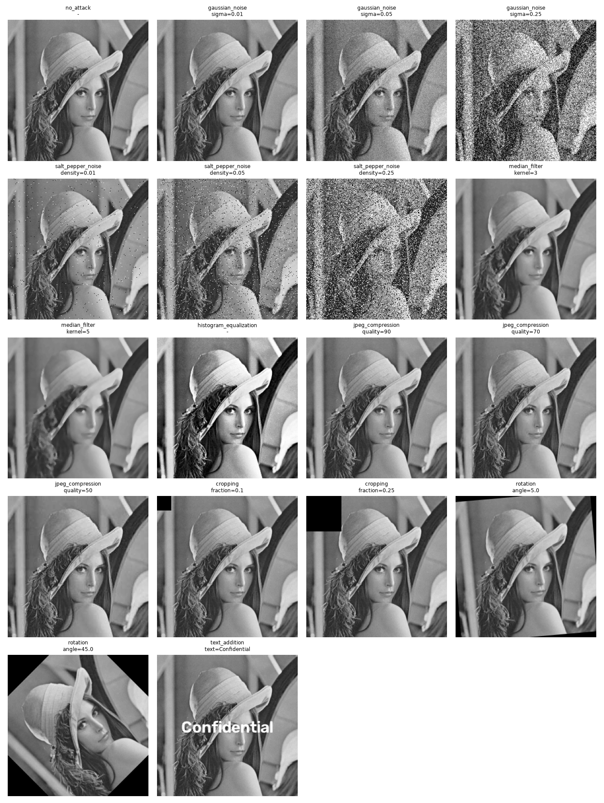
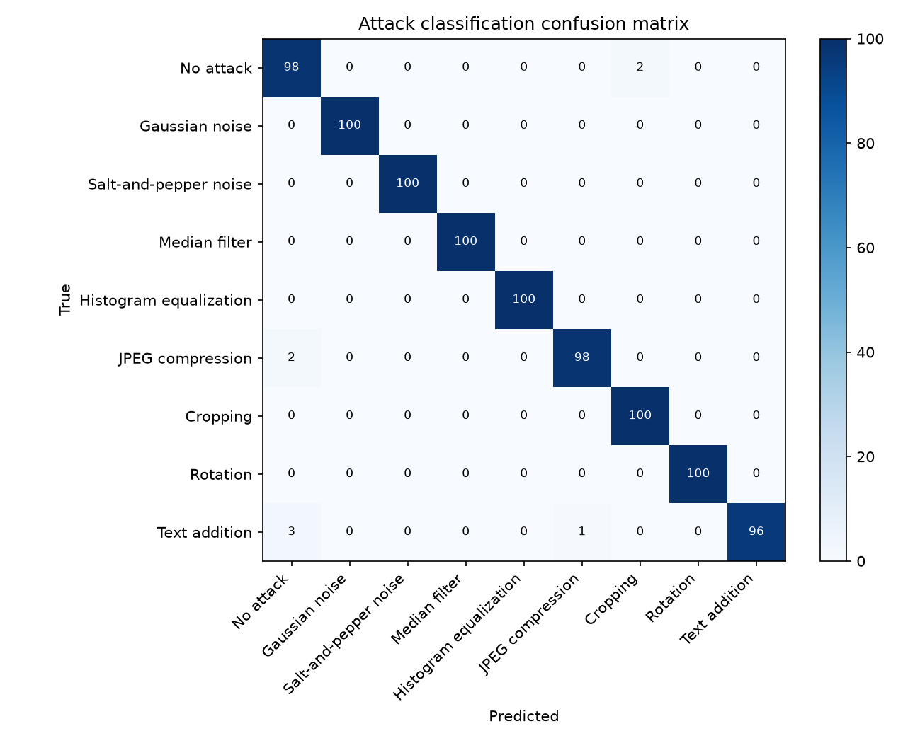

# NEQR Quantum Image Watermarking with Reversible Quantum Logic

[](https://github.com/chauhansachin13/neqr-quantum-watermarking/actions/workflows/ci.yml)
[](https://www.python.org/)
[](https://qiskit.org/)
[](LICENSE)

A complete, tested implementation of a **simulation-level quantum image
watermarking framework** built on the **Novel Enhanced Quantum Representation
(NEQR)** and **reversible quantum arithmetic** - Reverse Parallel Adder (RPA),
Reverse Parallel Subtractor (RPS), Dividing-4 (D4) and Quantum Equal (QE)
modules - together with an **AI-assisted attack classifier** (Random Forest)
that identifies which image-processing attack a watermarked image suffered.

The framework follows the design published in
*AI-assisted simulation-based quantum image watermarking using NEQR and
reversible quantum logic* (Array 31, 2026, 101035): watermark qubits are
generated from each 2x2 block of the cover image (pixel position bits + an
arithmetic average), embedded into the two least significant bits of every
pixel through RPA / QE / Pauli-X logic, and extracted with RPS / QE / Pauli-X
logic. Everything runs on classical hardware with IBM Qiskit circuit
simulation - no quantum advantage is claimed.

<p align="center">
  
  <br><em>Qiskit circuit for watermark qubit generation of one 2x2 block (146 qubits): four RPA(4) for the pixel position bits, RPA(8)+RPA(8)+RPA(9)+RPA(10)+D4 for the rounded arithmetic average, eight CNOTs for the final XOR.</em>
</p>

## What is inside

| Component | Module | Notes |
|---|---|---|
| NEQR encoding / decoding | `qwm.neqr` | Algorithm 1 & 2, 10-qubit circuit for a 2x2 block, statevector and Aer decoding |
| Reversible modules | `qwm.gates` | RHA/RFA/RPA, RHS/RFS/RPS, D4, QE as Qiskit gates, exhaustively verified |
| Exact reversible-circuit simulator | `qwm.simulation` | permutation-gate simulator (hundreds of qubits), Aer MPS/statevector wrappers |
| Watermark generation / embedding / extraction | `qwm.watermark`, `qwm.circuits` | bit-exact classical reference **and** full Qiskit circuits (Figs. 11, 13, 14) |
| Image metrics | `qwm.metrics.image` | MSE, PSNR, SSIM (global Eq. 19 and windowed), histograms |
| Quantum-state metrics | `qwm.metrics.quantum` | fidelity, trace distance, purity under depolarising / amplitude-damping / phase-damping / bit-flip channels |
| Attacks | `qwm.attacks` | Gaussian, salt & pepper, median, histogram equalisation, JPEG, cropping, rotation, text addition |
| AI-assisted attack classification | `qwm.classifier` | balanced 9-class dataset, Random Forest (Table 18), 5-fold CV, CI, binomial test, confusion matrix |
| Resource analysis | `qwm.resources` | closed-form budgets (354 / 400 / 400 qubits) and measured qubits / gates / depth |
| CLI + experiment runners | `qwm.cli`, `qwm.experiments` | `qwm demo`, `embed`, `extract`, `evaluate`, `attacks`, `quantum-metrics`, `classify`, `resources`, `draw` |

## Installation

```bash
git clone https://github.com/chauhansachin13/neqr-quantum-watermarking.git
cd neqr-quantum-watermarking
python -m venv .venv && source .venv/bin/activate
pip install -e ".[dev]"
```

Requires Python >= 3.10. Tested with Qiskit 2.5 / qiskit-aer 0.17, but any
Qiskit >= 1.0 works. The standard grayscale test images (Lena, Baboon,
Peppers, Barbara, Boat, House, Airplane, ...) are downloaded on first use into
`data/images/`; a handful of scikit-image samples and synthetic images are
available offline (`--offline`).

## Quick start

```bash
qwm demo                      # the worked 2x2 example through every stage (classical + Qiskit circuits)
qwm embed lena -o wm.png --mode lsb --save-watermark wb.npy
qwm extract wm.png --reference wb.npy
qwm evaluate                  # PSNR / SSIM / timing for all test images  -> results/imperceptibility.csv
qwm attacks --mode lsb        # robustness against 8 attacks             -> results/robustness_lsb*.csv, attacks.png
qwm quantum-metrics           # fidelity / trace distance / purity        -> results/quantum_metrics_lsb.csv
qwm classify --features descriptors   # Random Forest attack classifier   -> results/classifier/
qwm resources                 # qubit / gate / depth analysis             -> results/resources.json
qwm draw                      # render all circuits                       -> results/figures/
bash scripts/reproduce_all.sh # everything above
```

`qwm demo` prints the reference example of the design:

```
cover block |C> = [[50 60] [48 32]]
  PPB per pixel      : [(1, 1), (0, 0), (0, 0), (0, 1)]
  block sum / AA     : 190 / 48
  watermark Wb0..Wb7 : [1, 1, 0, 0, 1, 1, 0, 1]
Qiskit generation circuit (146 qubits): PPB=[(1, 1), (0, 0), (0, 0), (0, 1)] AA=48 Wb=[1, 1, 0, 0, 1, 1, 0, 1]
Qiskit embedding circuit  (64 qubits):  |W> = [49, 63, 51, 35]
Qiskit extraction circuit (88 qubits):  raw LSBs=[1, 0, 1, 1, 1, 1, 1, 1] extracted Wb=[1, 1, 0, 0, 1, 1, 0, 1]
```

### Python API

```python
import numpy as np
from qwm.data import load_image
from qwm.watermark import embed_image, extract_image, generate_watermark, bit_error_rate
from qwm.metrics import quality_report, image_metrics
from qwm.attacks import apply_attack
from qwm.circuits import WatermarkGenerationCircuit, WatermarkEmbeddingCircuit, WatermarkExtractionCircuit

cover = load_image("lena", 256)                       # uint8 grayscale
watermarked, bits = embed_image(cover, mode="lsb")    # bits: (128, 128, 8) watermark qubits per 2x2 block
print(quality_report(cover, watermarked))             # {'mse': 2.50, 'psnr': 44.14, 'ssim': 0.985, ...}

attacked = apply_attack(watermarked, "salt_pepper_noise", density=0.01, seed=0)
raw, verified = extract_image(attacked, bits)         # raw = blind read-out, verified = after the QE / Pauli-X step
print(bit_error_rate(raw, bits))                      # 0.005

# the same operations as Qiskit circuits, one 2x2 block at a time
block = np.array([[50, 60], [48, 32]])
gen = WatermarkGenerationCircuit(block);  wb = gen.run()["watermark"]          # [1,1,0,0,1,1,0,1]
emb = WatermarkEmbeddingCircuit(block, wb); w = emb.run()["watermarked_block"] # [[49,63],[51,35]]
ext = WatermarkExtractionCircuit(w, wb);  print(ext.run()["extracted_bits"])  # [1,1,0,0,1,1,0,1]
gen.circuit.draw("mpl")                                                       # any circuit can be drawn / transpiled

print(image_metrics(cover, watermarked, "depolarizing", p=0.05, max_blocks=8)) # fidelity, trace distance, purity
```

## How it works

1. **Representation.** Each 2x2 block of the 8-bit cover image is encoded as an
   NEQR state `|C> = 1/2 sum |f(YX)>|YX>` (8 intensity + 2 position qubits, Hadamards
   + Toffolis).
2. **Watermark generation** (per block, 8 bits).
   *Pixel position bits*: a 4-bit RPA adds the low and high nibble of every pixel;
   CNOT chains reduce the carry and sum registers to parities;
   `PPB_1 = parity(carries)`, `PPB_2 = parity(sums) xor PPB_1`.
   *Arithmetic average*: three RPAs add the four pixels, an RPA adds the rounding
   constant `|2>` and D4 divides by four: `AA = floor(S/4 + 0.5)`.
   *Watermark*: `Wb_k = s_k xor PPB` (Fig. 10).
3. **Embedding** (2 bpp). For each of the two LSBs: `RPA(C^{k+1}, Wb) -> XOR with
   C^{k+1} -> QE against C^k -> Pauli-X if equal -> replace C^k`.
4. **Extraction.** `XOR(W^{k+1}, W^k) -> RPS(., W^{k+1}) -> QE against Wb -> Pauli-X
   if different`. The RPS output is the blind read-out; the QE/Pauli-X stage is the
   reference verification.
5. **Evaluation.** MSE / PSNR / SSIM, eight attacks, fidelity / trace distance /
   purity of the NEQR states under noise channels, and a Random Forest that
   classifies the attack applied to a watermarked image.

The full derivation, wire semantics of every module and the worked example are
in [docs/algorithm.md](docs/algorithm.md).

## Results

All numbers below are produced by the code in this repository
(`bash scripts/reproduce_all.sh`, 256x256 grayscale images, Apple M4). Two
embedding rules are reported: the literal reversible-circuit rule of the design
(`paper`, RPA -> XOR -> QE -> Pauli-X) and plain LSB replacement (`lsb`,
Step 1 of the embedding description) - see *Implementation notes* for why they differ.

### Imperceptibility (Tables 5 / 12)

| Image | PSNR (dB), paper rule | SSIM, paper rule | PSNR (dB), LSB rule | SSIM, LSB rule | BER after blind extraction (LSB rule) |
|---|---|---|---|---|---|
| lena | 41.16 | 0.9717 | 44.14 | 0.9854 | 0.000 |
| baboon | 41.16 | 0.9893 | 44.12 | 0.9944 | 0.000 |
| peppers | 41.12 | 0.9730 | 43.97 | 0.9853 | 0.000 |
| barbara | 41.04 | 0.9837 | 44.08 | 0.9908 | 0.000 |
| boat | 41.11 | 0.9781 | 44.14 | 0.9889 | 0.000 |
| house | 42.16 | 0.9779 | 44.33 | 0.9819 | 0.000 |
| airplane | 41.16 | 0.9661 | 44.13 | 0.9822 | 0.000 |
| man | 41.14 | 0.9809 | 44.21 | 0.9906 | 0.000 |
| cameraman | 41.15 | 0.9593 | 44.20 | 0.9795 | 0.000 |
| lake | 41.12 | 0.9774 | 44.19 | 0.9886 | 0.000 |
| livingroom | 41.15 | 0.9825 | 44.09 | 0.9910 | 0.000 |
| walkbridge | 41.14 | 0.9914 | 44.13 | 0.9957 | 0.000 |
| woman_blonde | 41.15 | 0.9751 | 44.09 | 0.9869 | 0.000 |
| woman_darkhair | 41.12 | 0.9635 | 44.26 | 0.9818 | 0.000 |
| flowers | 41.20 | 0.9889 | 44.19 | 0.9943 | 0.000 |
| fruits | 41.16 | 0.9690 | 44.11 | 0.9837 | 0.000 |
| camera | 41.14 | 0.9644 | 44.17 | 0.9803 | 0.000 |
| moon | 41.01 | 0.9407 | 43.99 | 0.9689 | 0.000 |
| coins | 41.14 | 0.9696 | 44.19 | 0.9846 | 0.000 |
| astronaut | 40.86 | 0.9348 | 44.64 | 0.9901 | 0.000 |
| **mean** | **41.17** | **0.9719** | **44.17** | **0.9862** | **0.000** |

Embedding and extraction of a 256x256 image take well under a millisecond with
the vectorised reference implementation (the paper reports 0.4-0.6 s with its
Qiskit-based pipeline). Cover / watermarked histograms (Table 6):

<p align="center"></p>

### Robustness against attacks (Tables 7 / 8 / 15, `lsb` mode)

PSNR / SSIM are measured between the cover and the attacked watermarked image;
BER / NC compare the blindly extracted watermark bits with the reference bits.
The attack strengths of Table 7 (Gaussian sigma = 0.25, salt & pepper density = 0.25,
45 degree rotation, "Confidential" text, ...) are included next to milder settings.

| Attack | Parameters | PSNR (dB) | SSIM | BER | NC |
|---|---|---|---|---|---|
| no_attack | - | 44.17 | 0.986 | 0.000 | 1.000 |
| gaussian_noise | sigma=0.01 | 38.48 | 0.952 | 0.501 | -0.001 |
| gaussian_noise | sigma=0.05 | 26.01 | 0.629 | 0.496 | 0.007 |
| gaussian_noise | sigma=0.25 | 13.01 | 0.166 | 0.496 | 0.007 |
| salt_pepper_noise | density=0.01 | 25.36 | 0.807 | 0.005 | 0.990 |
| salt_pepper_noise | density=0.05 | 18.28 | 0.429 | 0.025 | 0.951 |
| salt_pepper_noise | density=0.25 | 11.29 | 0.122 | 0.124 | 0.751 |
| median_filter | kernel=3 | 31.02 | 0.898 | 0.399 | 0.201 |
| median_filter | kernel=5 | 27.41 | 0.808 | 0.446 | 0.108 |
| histogram_equalization | - | 18.24 | 0.743 | 0.488 | 0.023 |
| jpeg_compression | quality=90 | 39.00 | 0.971 | 0.492 | 0.016 |
| jpeg_compression | quality=70 | 34.68 | 0.944 | 0.501 | -0.002 |
| jpeg_compression | quality=50 | 32.89 | 0.924 | 0.499 | 0.003 |
| cropping | fraction=0.1 | 25.57 | 0.976 | 0.005 | 0.990 |
| cropping | fraction=0.25 | 17.56 | 0.923 | 0.032 | 0.936 |
| rotation | angle=5.0 | 14.63 | 0.352 | 0.498 | 0.004 |
| rotation | angle=45.0 | 9.87 | 0.181 | 0.500 | 0.000 |
| text_addition | text=Confidential | 21.24 | 0.933 | 0.017 | 0.967 |

<p align="center"></p>

As expected for an LSB scheme, the watermark survives impulse noise, cropping
and text addition (BER < 4 % at the milder settings, tamper maps localise the
edited blocks) while Gaussian noise, filtering, JPEG, histogram equalisation and
rotation randomise the bit-planes (BER ~ 50 %).

### Quantum noise and decoherence (Table 9, Lena, 8 sampled blocks per setting)

Metrics between the NEQR states of the cover block (rho) and of the
watermarked block (sigma) after each qubit passes through a noise channel of
strength p. The last column is the fidelity between the ideal and the noisy cover state.

| Noise channel | p | Fidelity F(ρ,σ) | Trace distance | Purity (cover) | Purity (watermarked) | Purity ratio | F(cover ideal, cover noisy) |
|---|---|---|---|---|---|---|---|
| none | 0.00 | 0.1048 | 0.9414 | 1.0000 | 1.0000 | 1.0000 | - |
| depolarizing | 0.01 | 0.0407 | 0.9723 | 0.8795 | 0.8799 | 0.9995 | 0.9376 |
| depolarizing | 0.05 | 0.0916 | 0.9220 | 0.5262 | 0.5273 | 0.9981 | 0.7223 |
| depolarizing | 0.10 | 0.1736 | 0.8541 | 0.2777 | 0.2787 | 0.9975 | 0.5174 |
| amplitude_damping | 0.01 | 0.0362 | 0.9795 | 0.9053 | 0.9047 | 1.0007 | 0.9512 |
| amplitude_damping | 0.05 | 0.0601 | 0.9587 | 0.6100 | 0.6085 | 1.0057 | 0.7758 |
| amplitude_damping | 0.10 | 0.0961 | 0.9276 | 0.3762 | 0.3745 | 1.0168 | 0.5961 |
| phase_damping | 0.01 | 0.0313 | 0.9819 | 0.9718 | 0.9722 | 0.9995 | 0.9857 |
| phase_damping | 0.05 | 0.0313 | 0.9735 | 0.8683 | 0.8702 | 0.9979 | 0.9304 |
| phase_damping | 0.10 | 0.0313 | 0.9633 | 0.7583 | 0.7612 | 0.9966 | 0.8652 |

### AI-assisted attack classification (Sec. 4.8)

Dataset: 9 balanced classes x 500 samples = 4,500 attacked watermarked images
generated from 20 cover images (random flips / rotations / crops before
embedding), 80:20 stratified split (3,600 / 900), stratified 5-fold CV on the
training set, Random Forest with the hyper-parameters of Table 18
(100 trees, Gini, unlimited depth, sqrt features, bootstrap, `random_state=42`).

| Features | Attack strengths | Test accuracy | Precision | Recall | F1 | 5-fold CV | 95 % CI (Wald) |
|---|---|---|---|---|---|---|---|
| normalised pixels (65,536-d, Table 17) | randomised | 66.44 % (598/900) | 65.89 % | 66.44 % | 65.30 % | 64.17 +/- 1.29 % | 63.36 - 69.53 % |
| normalised pixels (65,536-d, Table 17) | fixed (Table 7) | 72.78 % (655/900) | 72.06 % | 72.78 % | 72.20 % | 70.33 +/- 0.23 % | 69.87 - 75.69 % |
| distortion descriptors (137-d) | randomised | **99.11 %** (892/900) | 99.13 % | 99.11 % | 99.11 % | 98.92 +/- 0.10 % | 98.50 - 99.72 % |
| distortion descriptors (137-d) | fixed (Table 7) | **100.00 %** (900/900) | 100.00 % | 100.00 % | 100.00 % | 99.86 +/- 0.18 % | 100.00 - 100.00 % |

All four models are significantly better than the 11.11 % chance level
(one-sided binomial test, p < 1e-300). Per-class results of the descriptor model
with randomised attack strengths:

| Class | Attack | Accuracy | Precision | Recall | F1 |
|---|---|---|---|---|---|
| 0 | No attack | 99.22 % | 95.15 % | 98.00 % | 96.55 % |
| 1 | Gaussian noise | 100.00 % | 100.00 % | 100.00 % | 100.00 % |
| 2 | Salt-and-pepper noise | 100.00 % | 100.00 % | 100.00 % | 100.00 % |
| 3 | Median filter | 100.00 % | 100.00 % | 100.00 % | 100.00 % |
| 4 | Histogram equalization | 100.00 % | 100.00 % | 100.00 % | 100.00 % |
| 5 | JPEG compression | 99.67 % | 98.99 % | 98.00 % | 98.49 % |
| 6 | Cropping | 99.78 % | 98.04 % | 100.00 % | 99.01 % |
| 7 | Rotation | 100.00 % | 100.00 % | 100.00 % | 100.00 % |
| 8 | Text addition | 99.56 % | 100.00 % | 96.00 % | 97.96 % |

<p align="center"></p>

With the raw-pixel representation of Table 17 the forest mostly learns image
content, so *no attack*, *median filter*, *JPEG* and mild *Gaussian noise* are
confused (see `results/classifier/pixels_random/confusion_matrix.png`); the
96.56 % reported for that representation could not be reproduced on a dataset
with diverse covers and attack strengths. The 137-dimensional descriptor vector
(histogram statistics, saturated-pixel and border statistics, median-residual
and gradient statistics, spectral energy, 8x8 blockiness, bit-plane statistics
and an 8x8 thumbnail, `qwm.classifier.features.image_descriptors`) captures the
distortion itself and reaches 99-100 % with the same Random Forest.

### Quantum resource analysis (Sec. 4.9)

Closed-form budget of the design (n = 8): RPA / RPS `9n-4 = 68`, D4 `6n+3 = 51`,
QE `16n-11 = 117` CNOT-equivalents; 32 / 32 / 10 / 17 qubits per module;
**354** qubits for watermark generation (10 RPA + D4 + 12 CNOT), **400** for
embedding (8 RPA + 8 QE + 8 Pauli-X) and **400** for extraction (Table 21).

Measured on the circuits built here for one 2x2 block (`qwm resources`):

| Circuit | Qubits (data + ancilla) | Reversible gates | Depth | CNOT count after {U, CNOT} decomposition | Depth |
|---|---|---|---|---|---|
| Watermark generation | 146 (32 + 114) | 181 CNOT, 94 Toffoli, 10 SWAP, 11 X | 29 | 775 | 157 |
| Embedding | 64 (40 + 24) | 64 CNOT, 8 Toffoli, 8 SWAP, 15 X | 11 | 136 | 24 |
| Extraction | 88 (40 + 48) | 80 CNOT, 8 Toffoli, 37 X | 13 | 128 | 24 |

Image preparation cost (Table 11): FRQI `O(2^(4n))` = 4,294,967,296 vs NEQR
`O(q n 2^(2n))` = 4,194,304 operations for a 256x256 image. Payload: 8 bits per
2x2 block = 131,072 bits in a 256x256 image = **2 bpp** (Table 10).

## Implementation notes

* **Worked example reproduced exactly.** Block `[[50,60],[48,32]]` gives
  PPB `(1,1),(0,0),(0,0),(0,1)`, AA = 48, `Wb = 11001101`, watermarked pixels
  `49, 63, 51, 35` and the same eight bits after extraction - both from the
  classical reference code and from the simulated Qiskit circuits (Figs. 9-14,
  Tables 3-4). The test-suite pins these values.
* **PPB definition.** The text defines `T_i = RPA(P_i^(L), P_i^(R))` with two
  4-qubit outputs followed by `CNOT^(x)4`; this package implements
  `PPB_1 = parity(carry register)`, `PPB_2 = parity(sum register) xor PPB_1`,
  which is the reading that reproduces every value in Fig. 9.
* **Embedding rule.** Taken literally, "apply Pauli-X when the QE finds the XOR
  result equal to C^k, otherwise keep it" maps every input to `not C^k`, i.e. the
  `paper` rule inverts the two LSBs of each pixel regardless of the watermark
  (PSNR ~ 41.2 dB, 2-bit inversion), and the watermark is verified rather than
  read during extraction. The `lsb` mode implements the LSB replacement of
  Step 1 (PSNR ~ 44.2 dB, blind extraction, tamper localisation). The 59-60 dB
  reported in the paper is not obtainable from either rule: replacing the two
  LSBs of every pixel with content-derived bits gives an MSE of about 2.5
  (~ 44 dB) on average.
* **NEQR position selection.** Algorithm 2 of the paper toggles only `idx[1]`
  for all four pixels; the circuit here selects each pixel coordinate with X
  gates on the zero-valued position qubits (standard NEQR, Fig. 8 semantics), so
  encoding followed by measurement returns the block exactly.
* **D4.** Implemented with `n` SWAPs (the design counts `2n+1`); both realise
  the same permutation. Rounding of the average (`+0.5`) is realised by an extra
  RPA adding `|2>` before the division.
* **Classifier features.** The pixel representation of Table 17 is the default
  of `qwm classify`; `--features descriptors` selects the descriptor vector and
  `--params table7` freezes the attack strengths to Table 7.

## Project structure

```
qwm/
  neqr.py              NEQR circuits, closed-form states, decoding
  simulation.py        exact permutation-circuit simulator, Aer helpers
  gates/               adder.py (RHA/RFA/RPA), subtractor.py (RHS/RFS/RPS), divider.py (D4), equal.py (QE)
  watermark/           generation.py, embedding.py, extraction.py (classical reference, vectorised)
  circuits/            generation.py, embedding.py, extraction.py (Qiskit block circuits)
  metrics/             image.py (MSE/PSNR/SSIM/histograms), quantum.py (fidelity/trace distance/purity, noise)
  attacks.py           attack implementations and parameter presets
  classifier/          dataset.py, features.py, train.py (Random Forest protocol)
  resources.py         qubit/gate/depth analysis
  experiments.py       experiment runners producing CSV tables and figures
  cli.py               command-line interface
scripts/               reproduce_all.sh, worked_example.py, train_classifier.py
notebooks/             walkthrough.ipynb
tests/                 pytest suite (99 tests)
docs/algorithm.md      detailed algorithm description
results/               generated tables and figures
```

## Testing

```bash
pytest -q          # gates verified exhaustively, NEQR round trips, worked example, circuits vs reference, metrics, classifier, CLI
ruff check qwm tests scripts
```

## Reference

Sahu, A. K., Dhar, S., Deb, S., Khaldi, A., Sahu, M., Setiadi, D. R. I. M.
*AI-assisted simulation-based quantum image watermarking using NEQR and
reversible quantum logic.* Array 31 (2026) 101035.
https://doi.org/10.1016/j.array.2026.101035

This repository is an independent implementation of the published method; it
is not affiliated with the authors.

## License

[MIT](LICENSE)
