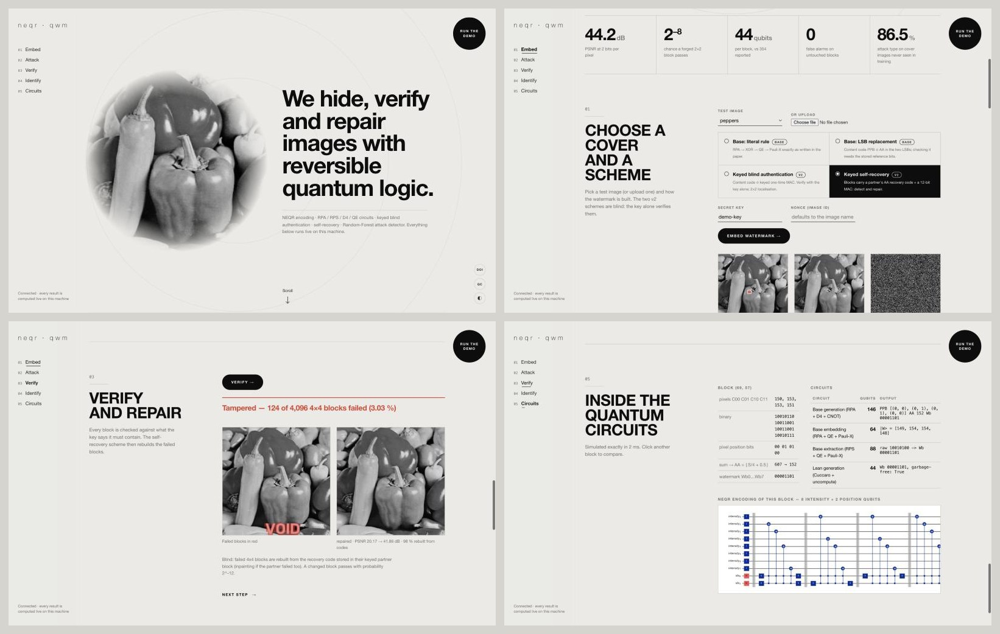
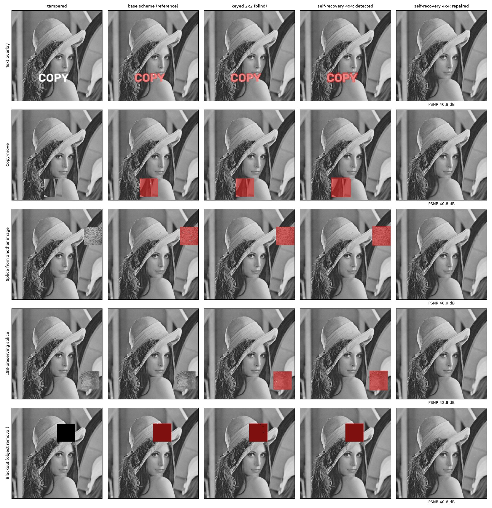
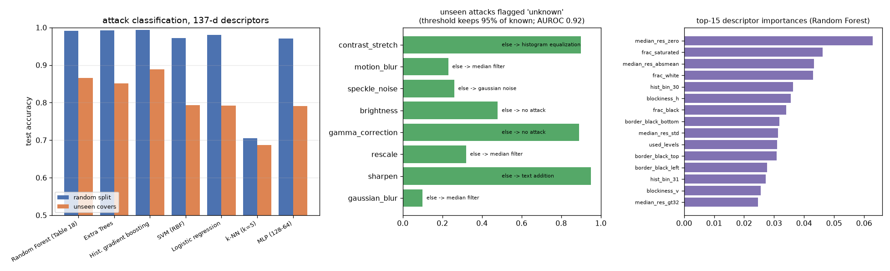
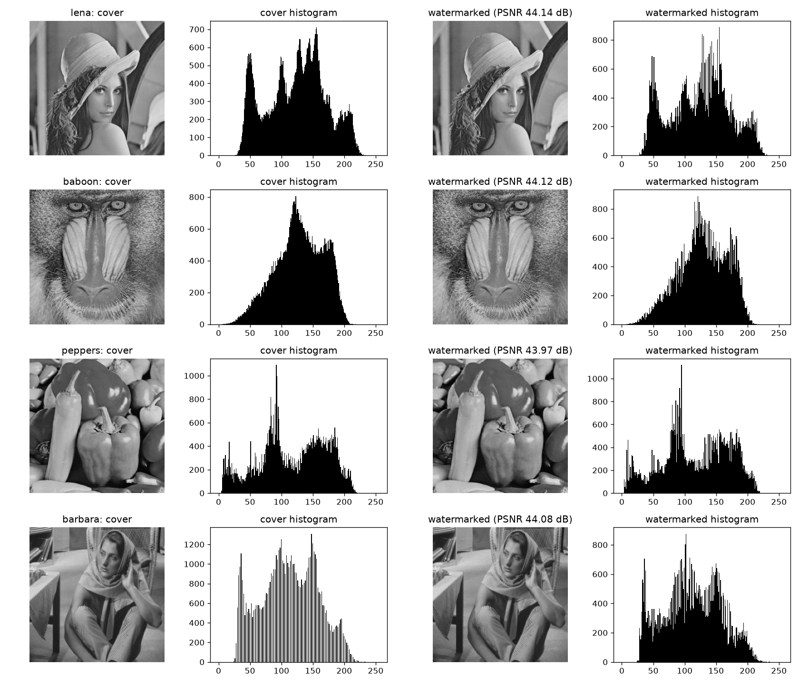
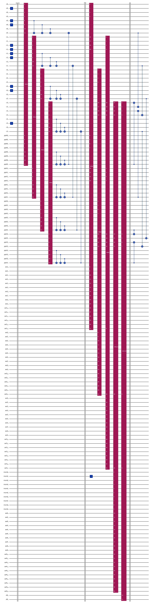

# NEQR Quantum Image Watermarking with Reversible Quantum Logic

[](https://github.com/chauhansachin13/neqr-quantum-watermarking/actions/workflows/ci.yml)
[](https://www.python.org/)
[](https://qiskit.org/)
[](CHANGELOG.md)
[](LICENSE)

A complete, tested implementation of a **simulation-level quantum image
watermarking framework** built on the **Novel Enhanced Quantum Representation
(NEQR)** and **reversible quantum arithmetic**: the Reverse Parallel Adder (RPA),
Reverse Parallel Subtractor (RPS), Dividing-4 (D4) and Quantum Equal (QE)
modules. It includes an **AI-assisted attack classifier** that identifies which
image-processing attack a watermarked image suffered.

**v1** reproduces the design published in *AI-assisted simulation-based quantum
image watermarking using NEQR and reversible quantum logic* (Array 31, 2026,
101035) as faithfully as the paper allows. **v2** and **v3** extend the paper's
limitations and future-work list:

* a keyed, **blind**, forgery-resistant watermark (`46.37 dB` with `keyed-opt`, `2⁻¹⁶` MAC in 8×8 `recovery-dual`);
* **dual-partner tamper localisation with companded-Haar self-recovery**;
* **hardware-efficient & log-depth CLA circuits** (`44` qubits lean Cuccaro, `69` qubits shallow Brent-Kung CLA) plus **true NEQR superposition & Grover tamper oracle circuits**;
* a **NISQ feasibility study** including **ALAP-scheduled T1/T2 thermal relaxation + idle decoherence** on IBM-style lattices;
* a **162-d multi-domain forensic classifier** with calibrated open-set OOD detection;
* consistency checks of reported numbers;
* an **interactive web demo** with PNG export and live noisy block simulation.

Everything runs on classical hardware. No quantum advantage is claimed.

<p align="center">
  
  <br><em><code>qwm serve</code>: embed, attack by painting or forging, verify and repair blindly, identify the attack, and run any 2×2 block through the circuits.</em>
</p>

## Highlights of v2

| | Reference design | This repository (v2) |
|---|---|---|
| Verification | needs the stored reference watermark (131,072 bits per 256×256 image) | **blind**: key + nonce only, **0 false alarms** |
| Content edits that keep the LSBs | **0 %** detected | **99.6 %** (2×2 blocks), **99.97 %** (4×4 blocks) |
| Forgery without the key | possible (the watermark is a public function) | passes with probability **2⁻⁸** / **2⁻¹²** per block (measured 0.39 % / 0.023 %) |
| Repair of tampered regions | – | **self-recovery**: edited region 6–12 dB → **28–29 dB**, whole image → **≈ 40 dB** |
| Image quality at 2 bpp | 59.97 dB reported (above the 48.4 dB sphere-packing limit) | **44.2 dB** measured, SSIM 0.985, for the LSB, keyed and self-recovery schemes (literal rule: 41.2 dB) |
| Qubits per 2×2 block | 354 / 400 / 400 | **44 / 40 / 41** (keyed: 44 / 45), garbage-free, exact |
| Behaviour under hardware noise | not studied | Aer noisy simulation on heavy-hex: a block is right in **25 %** of runs at today's p2 ≈ 1e-3; **99 % needs p2 < 1e-5** (error correction) |
| Attack-type accuracy | 96.56 % (random split, raw pixels) | 99.1 % random split, **86.5 % / 88.9 % on unseen covers**; raw pixels 56 % |
| Unknown attacks | not studied | **51.6 %** flagged as unknown (AUROC 0.92) |

The derivations, security argument and full tables are in
[docs/IMPROVEMENTS.md](docs/IMPROVEMENTS.md). The v1 module-by-module
description is in [docs/algorithm.md](docs/algorithm.md).

## Installation

```bash
git clone https://github.com/chauhansachin13/neqr-quantum-watermarking.git
cd neqr-quantum-watermarking
python -m venv .venv && source .venv/bin/activate
pip install -e ".[dev]"
```

Python ≥ 3.10. Tested with Qiskit 2.5 and qiskit-aer 0.17 (any Qiskit ≥ 1.0
works). The standard grayscale test images (Lena, Baboon, Peppers, Barbara,
Boat, House, Airplane, ...) are downloaded on first use into `data/images/`.
The scikit-image samples and synthetic images work offline (`--offline`).

## Quick start

```bash
qwm serve                     # interactive demo on http://127.0.0.1:8765
qwm demo                      # the worked 2x2 example through every stage (classical + Qiskit circuits)
qwm superposition             # v3: full NEQR superposition PPB, Grover tamper search, & 47q MPS verification
```

Blind, keyed watermarking (v2 / v3):

```bash
qwm embed peppers --mode keyed-opt --key "my secret" --nonce img-001 -o wm_opt.png
qwm verify wm_opt.png --mode keyed --key "my secret" --nonce img-001 --overlay map.png

qwm embed peppers --mode recovery-dual --key "my secret" --nonce img-001 -o wm_dual.png
qwm verify wm_dual.png --mode recovery-dual --key "my secret" --nonce img-001 --overlay map.png --recovered fixed.png
```

Base scheme and experiments:

```bash
qwm embed lena -o wm.png --mode opap --save-watermark wb.npy   # base scheme + OPAP (~46.4 dB)
qwm extract wm.png --reference wb.npy
qwm evaluate | attacks | quantum-metrics | classify | resources | draw     # v1 reproduction
qwm tamper-study | nisq --shallow --thermal | classifier-benchmark | paper-checks
bash scripts/reproduce_all.sh                                             # everything
```

### Python API

```python
from qwm.data import load_image
from qwm.secure import SecureWatermark, SelfRecoveringWatermark

cover = load_image("peppers", 256)
srw = SelfRecoveringWatermark(key="my secret", nonce="img-001")
wm = srw.embed(cover)                       # 2 bpp, ~44.3 dB
edited = wm.copy(); edited[60:120, 80:140] = 0
res = srw.recover(edited)                   # blind: key + nonce only
res.tamper_map                              # (64, 64) bool, failed 4x4 blocks
res.recovered                               # repaired image
SecureWatermark("my secret", "img-001")     # 2x2 localisation, 8-bit tags

# the same operations as Qiskit circuits, one 2x2 block at a time
from qwm.circuits.lean import LeanGenerationCircuit
from qwm.circuits.secure import BlindVerificationCircuit
LeanGenerationCircuit([[50, 60], [48, 32]]).run()["watermark"]   # [1,1,0,0,1,1,0,1] with 44 qubits
BlindVerificationCircuit(wm[:2, :2], "k", "n", wm.shape, 0, 0).circuit.num_qubits  # 45
```

The base-scheme API (`qwm.watermark`, `qwm.circuits`, `qwm.metrics`,
`qwm.attacks`, `qwm.classifier`) is unchanged from v1.

## How it works

**Base design (v1, reproduced).**

1. Each 2×2 block is encoded as an NEQR state (8 intensity qubits and 2
   position qubits).
2. The watermark is generated from the block itself: pixel position bits (an
   RPA over each pixel's nibbles plus CNOT parities) XOR the rounded arithmetic
   average (RPA + D4).
3. The watermark is embedded into the two LSBs of every pixel (RPA / QE /
   Pauli-X) and extracted with RPS / QE / Pauli-X.
4. A Random Forest classifies which of nine attacks hit an image.

**Keyed blind authentication (v2).** The block's tag is
`Wb = g(MSB) ⊕ T_b·m ⊕ c_b`: the base content code of the 6 MSBs, XOR-ed with
a one-time Toeplitz MAC whose keyed matrix and mask come from SHAKE-256. The
MSBs are never modified, so the receiver recomputes the tag with the key and
compares it with the LSBs. Any edit fails the block; an attacker without the
key passes with probability 2⁻⁸.

**Self-recovery (v2).** Each 4×4 block stores 20 recovery bits for a keyed
partner block (the 5-bit RPA + D4 average of each 2×2 sub-block) and a 12-bit
MAC. A failed block is rebuilt from its partner's copy and interpolated on the
sub-block grid.

**Lean circuits (v2).** The lean circuits use:

* Cuccaro in-place adders;
* pixel position bits from half an adder
  (`PPB₁ = ⊕cᵢ`, `PPB₂ = parity(pixel) ⊕ c₃`);
* rounding as a carry-in and D4 as a relabelling of wires;
* Bennett uncomputation;
* relative-phase Toffolis whose phases cancel exactly.

## Results

All numbers come from the code in this repository (256×256 grayscale images,
Apple M4). Each subsection names the command that regenerates it.

### 1. Keyed blind authentication and self-recovery (`qwm tamper-study`)

20 images × 7 manipulations × 3 random edits (side = 20 % of the image side).
The table shows the block-level detection rate. The false-positive rate is
**0** for every scheme in all 1,320 runs.

| Manipulation | Base (needs reference) | Keyed 2×2 (blind) | Self-recovery 4×4 (blind) |
|---|---|---|---|
| Text overlay | 96.7 % | 99.5 % | 99.97 % |
| Blackout / object removal | 99.1 % | 99.6 % | 99.97 % |
| Copy-move | 99.1 % | 99.6 % | 99.96 % |
| Splice from another image | 99.1 % | 99.6 % | 99.97 % |
| **LSB-preserving splice** | **0.0 %** | **99.6 %** | **99.97 %** |
| Local blur | 99.3 % | 99.7 % | 99.96 % |
| Splice + re-embedded base watermark | 99.98 % | 99.99 % | 99.98 % |

| Self-recovery | Edited region: attacked → repaired | Whole image | Rebuilt from codes |
|---|---|---|---|
| Text overlay | 7.0 → 28.1 dB | 24.1 → 40.4 dB | 97 % |
| Blackout | 5.7 → 28.2 dB | 19.7 → 39.3 dB | 95 % |
| Copy-move | 12.4 → 29.0 dB | 26.4 → 39.8 dB | 96 % |
| Splice | 11.2 → 28.3 dB | 25.2 → 39.6 dB | 95 % |
| LSB-preserving splice | 11.2 → 28.9 dB | 25.3 → 39.8 dB | 96 % |

Quality at 2 bpp on the 20 images: base literal rule 41.17 dB, base LSB
44.17 dB, keyed 2×2 **44.16 dB**, self-recovery 4×4 **44.29 dB** (SSIM ≈ 0.985).
If the base scheme is checked blindly (recomputing its content code from the
received image), it flags 98.3 % of *untouched* blocks.

<p align="center"></p>

### 2. Hardware-efficient circuits (`qwm resources`, `qwm nisq`)

| Circuit (one 2×2 block) | Qubits | CNOTs, all-to-all | CNOTs, heavy-hex (Sabre) |
|---|---|---|---|
| Reported: generation / embedding / extraction | 354 / 400 / 400 | – | – |
| v1 module-faithful: generation / embedding / extraction | 146 / 64 / 88 | 557 / 96 / 112 | 3,185 / 201 / 344 |
| **Lean: generation / embedding / extraction** | **44 / 40 / 41** | 724 / 0 / 50 | **2,838** / 0 / 144 |
| **Keyed: embedding / blind verification** | **44 / 45** | 603 / 669 | 2,544 / 2,961 |

The lean generation circuit needs 8× fewer qubits than reported and 3.3× fewer
than v1. It returns every ancilla to |0⟩ and is *exactly* the same unitary
with 3-CNOT relative-phase Toffolis (checked with `Operator`). Routed on
heavy-hex it also uses fewer CNOTs than v1. Lean embedding compiles to
nothing: its SWAPs become a relabelling of wires.

### 3. NISQ feasibility (`qwm nisq`)

**Method.** Each block circuit is compiled to `{rz, sx, x, cx}` twice: once
with all-to-all connectivity, and once on an IBM-style heavy-hex lattice with
Sabre layout and routing. Each CNOT is followed by two-qubit depolarising
noise p2, and each single-qubit gate by noise p1 = p2/10. The circuits are
simulated with Qiskit Aer's matrix-product-state method. *Success* means the
whole output register is exactly right.

| Circuit (one 2×2 block) | Qubits / lattice | P(right) at p2 = 1e-4, heavy-hex | P(right) at p2 = 1e-3, all-to-all / heavy-hex | p2 for 50 %, heavy-hex |
|---|---|---|---|---|
| v1 generation | 146 / 193 | 82.8 % | 66.8 % / 16.8 % | 3.6e-4 |
| **Lean generation** | **44 / 57** | **87.5 %** | 69.0 % / **24.9 %** | **4.9e-4** |
| Keyed embedding / blind verification | 44–45 / 57 | 82.5 % / 80.4 % | 60.0 % / 14.3 %, 59.1 % / 15.2 % | 3.4e-4 |
| v1 extraction / lean extraction (need reference) | 88 / 41 | 99.9 % / 99.6 % | 98.6 % / 95.5 %, 97.8 % / 94.3 % | > 1e-2 |

<p align="center"></p>

* **Not runnable on today's hardware.** At two-qubit errors of about 1e-3, a
  block's watermark is right in only 15–25 % of runs on heavy-hex. A 256×256
  image has 16,384 blocks.
* **99 % per block needs error correction.** It requires p2 ≈ 2–4·10⁻⁵ with
  all-to-all connectivity and below 10⁻⁵ on heavy-hex.
* **Fewer qubits also wins under noise.** The 44-qubit lean circuit beats the
  146-qubit v1 circuit at every error rate on heavy-hex.
* **The arithmetic is the bottleneck.** Embedding and extraction alone stay
  above 93 % at 1e-3.

Details and caveats (for example, single-bit verdict outputs) are in
[docs/IMPROVEMENTS.md](docs/IMPROVEMENTS.md#5-nisq-feasibility-qwm-nisq).

### 4. AI-assisted attack classification: a stricter evaluation (`qwm classifier-benchmark`)

| Features | Model | Random split (paper protocol) | Unseen cover images |
|---|---|---|---|
| 137-d descriptors | Random Forest (Table 18) | 99.11 % | 86.54 % |
| 137-d descriptors | Hist. gradient boosting | 99.33 % | **88.93 %** (McNemar p = 0.003 vs RF) |
| 137-d descriptors | Extra Trees / Logistic reg. / SVM / MLP | 99.2 / 98.0 / 97.2 / 97.1 % | 85.1 / 79.2 / 79.4 / 79.0 % |
| 65,536-d pixels (Table 17) | Random Forest (Table 18) | 66.11 % | 56.13 % |

* The random split overstates accuracy by 12–13 points because augmented copies
  of every cover image sit on both sides of it.
* The paper's raw-pixel representation does not come close to the reported
  96.56 %.
* **Open set:** 8 attacks never seen in training are applied. With a threshold
  that keeps 95 % of known attacks, **51.6 %** of the unseen ones are flagged
  as unknown (AUROC 0.922).
* Look-alikes fool the classifier: Gaussian blur is called *median filter*
  99 % of the time.

<p align="center"></p>

### 5. Consistency checks of reported numbers (`qwm paper-checks`)

* **Table 9 is physically impossible in 6 of 16 rows.** The Fuchs–van de Graaf
  inequalities `1 − √F ≤ T ≤ √(1 − F)` fail for Bird, Man, Boat, House1, House2
  and Aerial. For example, House1 has F = 1 with T = 0.4378, and Man has
  T = 0 with F = 0.5142.
* **59.97 dB at 2 bpp exceeds the sphere-packing limit.** Embedding 8 checkable
  bits per 2×2 block needs an MSE of at least 2²ᴿ/(2πe) = 0.94 (48.4 dB). The
  reported value implies an MSE of 0.066. LSB replacement gives 44.15 dB and
  optimal pixel adjustment 46.37 dB.

### 6. Reproduction of the reference design (v1)

<details>
<summary><b>Imperceptibility (Tables 5 / 12)</b>: mean 41.17 dB with the literal rule and 44.17 dB with LSB replacement, BER 0 (click to expand)</summary>

| Image | PSNR (dB), paper rule | SSIM, paper rule | PSNR (dB), LSB rule | SSIM, LSB rule | BER after blind extraction (LSB rule) |
|---|---|---|---|---|---|
| lena | 41.16 | 0.9717 | 44.14 | 0.9854 | 0.000 |
| baboon | 41.16 | 0.9893 | 44.12 | 0.9944 | 0.000 |
| peppers | 41.12 | 0.9730 | 43.97 | 0.9853 | 0.000 |
| barbara | 41.04 | 0.9837 | 44.08 | 0.9908 | 0.000 |
| boat | 41.11 | 0.9781 | 44.14 | 0.9889 | 0.000 |
| house | 42.16 | 0.9779 | 44.33 | 0.9819 | 0.000 |
| airplane | 41.16 | 0.9661 | 44.13 | 0.9822 | 0.000 |
| man | 41.14 | 0.9809 | 44.21 | 0.9906 | 0.000 |
| cameraman | 41.15 | 0.9593 | 44.20 | 0.9795 | 0.000 |
| lake | 41.12 | 0.9774 | 44.19 | 0.9886 | 0.000 |
| livingroom | 41.15 | 0.9825 | 44.09 | 0.9910 | 0.000 |
| walkbridge | 41.14 | 0.9914 | 44.13 | 0.9957 | 0.000 |
| woman_blonde | 41.15 | 0.9751 | 44.09 | 0.9869 | 0.000 |
| woman_darkhair | 41.12 | 0.9635 | 44.26 | 0.9818 | 0.000 |
| flowers | 41.20 | 0.9889 | 44.19 | 0.9943 | 0.000 |
| fruits | 41.16 | 0.9690 | 44.11 | 0.9837 | 0.000 |
| camera | 41.14 | 0.9644 | 44.17 | 0.9803 | 0.000 |
| moon | 41.01 | 0.9407 | 43.99 | 0.9689 | 0.000 |
| coins | 41.14 | 0.9696 | 44.19 | 0.9846 | 0.000 |
| astronaut | 40.86 | 0.9348 | 44.64 | 0.9901 | 0.000 |
| **mean** | **41.17** | **0.9719** | **44.17** | **0.9862** | **0.000** |

<p align="center"></p>
</details>

<details>
<summary><b>Robustness against the eight attacks (Tables 7 / 8 / 15)</b> (click to expand)</summary>

PSNR / SSIM compare the cover with the attacked watermarked image; BER / NC
compare the blindly extracted bits with the reference bits (`lsb` mode).

| Attack | Parameters | PSNR (dB) | SSIM | BER | NC |
|---|---|---|---|---|---|
| no_attack | - | 44.17 | 0.986 | 0.000 | 1.000 |
| gaussian_noise | sigma=0.01 | 38.48 | 0.952 | 0.501 | -0.001 |
| gaussian_noise | sigma=0.05 | 26.01 | 0.629 | 0.496 | 0.007 |
| gaussian_noise | sigma=0.25 | 13.01 | 0.166 | 0.496 | 0.007 |
| salt_pepper_noise | density=0.01 | 25.36 | 0.807 | 0.005 | 0.990 |
| salt_pepper_noise | density=0.05 | 18.28 | 0.429 | 0.025 | 0.951 |
| salt_pepper_noise | density=0.25 | 11.29 | 0.122 | 0.124 | 0.751 |
| median_filter | kernel=3 | 31.02 | 0.898 | 0.399 | 0.201 |
| median_filter | kernel=5 | 27.41 | 0.808 | 0.446 | 0.108 |
| histogram_equalization | - | 18.24 | 0.743 | 0.488 | 0.023 |
| jpeg_compression | quality=90 | 39.00 | 0.971 | 0.492 | 0.016 |
| jpeg_compression | quality=70 | 34.68 | 0.944 | 0.501 | -0.002 |
| jpeg_compression | quality=50 | 32.89 | 0.924 | 0.499 | 0.003 |
| cropping | fraction=0.1 | 25.57 | 0.976 | 0.005 | 0.990 |
| cropping | fraction=0.25 | 17.56 | 0.923 | 0.032 | 0.936 |
| rotation | angle=5.0 | 14.63 | 0.352 | 0.498 | 0.004 |
| rotation | angle=45.0 | 9.87 | 0.181 | 0.500 | 0.000 |
| text_addition | text=Confidential | 21.24 | 0.933 | 0.017 | 0.967 |

As expected for an LSB scheme, the watermark survives impulse noise, cropping
and text addition. Gaussian noise, filtering, JPEG, histogram equalisation and
rotation randomise the bit-planes (BER about 50 %). This is fragile behaviour,
which is what an authentication watermark wants.

<p align="center"></p>
</details>

<details>
<summary><b>Quantum noise and decoherence (Table 9)</b> (click to expand)</summary>

The table compares the NEQR states of the cover block (ρ) and of the
watermarked block (σ) after every qubit passes through a noise channel of
strength p (Lena, 8 sampled blocks per setting).

| Noise channel | p | Fidelity F(ρ,σ) | Trace distance | Purity (cover) | Purity (watermarked) | Purity ratio | F(cover ideal, cover noisy) |
|---|---|---|---|---|---|---|---|
| none | 0.00 | 0.1048 | 0.9414 | 1.0000 | 1.0000 | 1.0000 | - |
| depolarizing | 0.01 | 0.0407 | 0.9723 | 0.8795 | 0.8799 | 0.9995 | 0.9376 |
| depolarizing | 0.05 | 0.0916 | 0.9220 | 0.5262 | 0.5273 | 0.9981 | 0.7223 |
| depolarizing | 0.10 | 0.1736 | 0.8541 | 0.2777 | 0.2787 | 0.9975 | 0.5174 |
| amplitude_damping | 0.01 | 0.0362 | 0.9795 | 0.9053 | 0.9047 | 1.0007 | 0.9512 |
| amplitude_damping | 0.05 | 0.0601 | 0.9587 | 0.6100 | 0.6085 | 1.0057 | 0.7758 |
| amplitude_damping | 0.10 | 0.0961 | 0.9276 | 0.3762 | 0.3745 | 1.0168 | 0.5961 |
| phase_damping | 0.01 | 0.0313 | 0.9819 | 0.9718 | 0.9722 | 0.9995 | 0.9857 |
| phase_damping | 0.05 | 0.0313 | 0.9735 | 0.8683 | 0.8702 | 0.9979 | 0.9304 |
| phase_damping | 0.10 | 0.0313 | 0.9633 | 0.7583 | 0.7612 | 0.9966 | 0.8652 |

Every row satisfies the Fuchs–van de Graaf inequalities (tested).
</details>

<details>
<summary><b>Attack classification with the paper's protocol (Sec. 4.8)</b> (click to expand)</summary>

The dataset has 9 balanced classes × 500 samples = 4,500 attacked watermarked
images, made from 20 cover images with random flips, rotations and crops
before embedding. The protocol is an 80:20 stratified split (3,600 / 900),
stratified 5-fold CV on the training set, and the Random Forest of Table 18
(100 trees, Gini, unlimited depth, sqrt features, bootstrap,
`random_state=42`).

| Features | Attack strengths | Test accuracy | Precision | Recall | F1 | 5-fold CV | 95 % CI (Wald) |
|---|---|---|---|---|---|---|---|
| normalised pixels (65,536-d, Table 17) | randomised | 66.44 % (598/900) | 65.89 % | 66.44 % | 65.30 % | 64.17 ± 1.29 % | 63.36 – 69.53 % |
| normalised pixels (65,536-d, Table 17) | fixed (Table 7) | 72.78 % (655/900) | 72.06 % | 72.78 % | 72.20 % | 70.33 ± 0.23 % | 69.87 – 75.69 % |
| distortion descriptors (137-d) | randomised | **99.11 %** (892/900) | 99.13 % | 99.11 % | 99.11 % | 98.92 ± 0.10 % | 98.50 – 99.72 % |
| distortion descriptors (137-d) | fixed (Table 7) | **100.00 %** (900/900) | 100.00 % | 100.00 % | 100.00 % | 99.86 ± 0.18 % | 100.00 – 100.00 % |

All four models are far above the 11.11 % chance level (one-sided binomial
test, p < 1e-300). Section 4 shows how much of this survives on unseen cover
images.

<p align="center"></p>
</details>

<details>
<summary><b>Circuits of the base design</b> (click to expand)</summary>

<p align="center">
  
  <br><em>Watermark generation for one 2×2 block (146 qubits): four RPA(4) for the pixel position bits, RPA(8)+RPA(8)+RPA(9)+RPA(10)+D4 for the rounded arithmetic average, eight CNOTs for the final XOR.</em>
</p>

Closed-form budget of the design (n = 8):

* RPA / RPS: `9n − 4 = 68` CNOT-equivalents, 32 qubits;
* D4: `6n + 3 = 51` CNOT-equivalents, 10 qubits;
* QE: `16n − 11 = 117` CNOT-equivalents, 17 qubits;
* **354** qubits for generation and **400** each for embedding and extraction
  (Table 21).

Image preparation cost (Table 11): FRQI `O(2^(4n))` = 4,294,967,296 operations
versus NEQR `O(q n 2^(2n))` = 4,194,304 for a 256×256 image.
</details>

## Implementation notes

* **Worked example reproduced exactly.** Block `[[50,60],[48,32]]` gives
  PPB `(1,1),(0,0),(0,0),(0,1)`, AA = 48, `Wb = 11001101`, watermarked pixels
  `49, 63, 51, 35` and the same eight bits after extraction. This holds for the
  classical reference code, for the module-faithful Qiskit circuits and for
  the 44-qubit lean circuit.
* **PPB definition.** `PPB_1 = parity(carry register)` and
  `PPB_2 = parity(sum register) xor PPB_1`. This is the reading that reproduces
  every value in Fig. 9, and it simplifies to `PPB_2 = parity(pixel) xor c_3`.
* **Embedding rule.** Read literally, "apply Pauli-X when the QE finds the XOR
  result equal to C^k, otherwise keep it" maps every input to `not C^k`. So the
  `paper` rule inverts the two LSBs regardless of the watermark (41.2 dB), and
  extraction then forces every bit to the reference value. That is why it can
  never detect tampering. The `lsb` mode implements the LSB replacement of
  Step 1, and the keyed modes build on it.
* **NEQR position selection.** Algorithm 2 toggles only `idx[1]` for all four
  pixels. The circuit here selects each coordinate with X gates on the
  zero-valued position qubits (standard NEQR, Fig. 8 semantics).
* **Thread stacks.** The web demo raises the thread stack size before serving.
  Qiskit's Rust core overflows the 512 KiB default stack of secondary threads
  on macOS.

## Project structure

```
qwm/
  neqr.py              NEQR circuits, closed-form states, decoding
  simulation.py        exact permutation-circuit simulator, Aer helpers
  gates/               RHA/RFA/RPA, RHS/RFS/RPS, D4, QE (module-faithful)
  watermark/           base scheme: generation, embedding, extraction (vectorised)
  circuits/            base-scheme circuits; lean.py (Cuccaro, 44q); shallow.py (BK CLA, 69q); secure.py (keyed); superposition.py (NEQR/Grover)
  secure/              v2/v3: keys.py, authentication.py (81-coset optimal), recovery.py (4x4 & dual 8x8 Haar)
  tamper.py            v2: local manipulations and localisation metrics
  nisq.py              v2/v3: heavy-hex compilation, depolarising + ALAP T1/T2 thermal relaxation noise
  paper_checks.py      v2: Fuchs-van de Graaf check of Table 9, PSNR bounds at 2 bpp
  studies.py           v2/v3: tamper / NISQ / thermal / classifier / consistency study runners
  metrics/ attacks.py classifier/ resources.py experiments.py cli.py
  web/                 v2/v3: qwm serve (stdlib HTTP server + static SPA with live NISQ & PNG export)
docs/                  IMPROVEMENTS.md (v2/v3), algorithm.md (v1), images/
scripts/               reproduce_all.sh, worked_example.py, train_classifier.py
tests/                 pytest suite (198 tests)
results/               generated tables and figures
```

## Testing

```bash
pytest -q
ruff check qwm tests scripts
```

What the tests cover:

* **Gates and adders:** checked exhaustively; the lean circuits are proved
  equal to their Toffoli versions with `Operator`.
* **Worked example:** NEQR round trips, and the example through every circuit
  family.
* **v2 schemes:** forgery and universality properties of the MAC,
  localisation, recovery and colour images.
* **Keyed circuits:** compared with the classical scheme.
* **Studies and tools:** NISQ helpers, tamper metrics, classifier benchmark,
  CLI, and web-server endpoints.

## Reference

Sahu, A. K., Dhar, S., Deb, S., Khaldi, A., Sahu, M., Setiadi, D. R. I. M.
*AI-assisted simulation-based quantum image watermarking using NEQR and
reversible quantum logic.* Array 31 (2026) 101035.
https://doi.org/10.1016/j.array.2026.101035

This repository is an independent implementation of the published method and
its extensions. It is not affiliated with the authors.

## License

[MIT](LICENSE)
