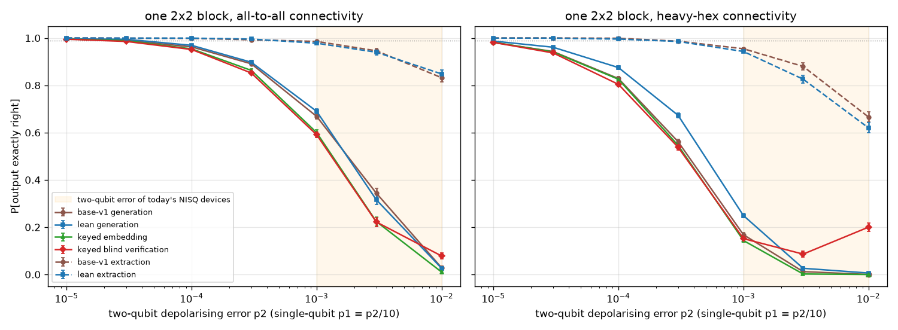

# What v2 adds beyond the reference design

Version 1 of this repository reproduced the reference design (*AI-assisted
simulation-based quantum image watermarking using NEQR and reversible quantum
logic*, Array 31, 2026, 101035) as faithfully as the paper allows. Version 2
takes up the paper's own limitations and future-work list. It adds six things:

1. a check of reported numbers that can be verified without re-running anything;
2. a keyed, blind, forgery-resistant variant of the watermark;
3. tamper localisation with self-recovery;
4. hardware-efficient circuits;
5. a NISQ feasibility study with noisy simulation on IBM-style hardware;
6. a stricter evaluation of the AI attack classifier.

Every number below comes from the code in this repository. Commands to
regenerate each table are given in each section.

---

## 1. Consistency checks of reported numbers (`qwm paper-checks`)

### 1.1 Table 9 breaks the Fuchs–van de Graaf inequalities

For any two quantum states the fidelity `F` (Eq. 20) and the trace
distance `T` (Eq. 21) satisfy

```
1 - sqrt(F)  <=  T  <=  sqrt(1 - F)
```

So `F = 1` forces `T = 0`, `T = 0` forces `F = 1`, and `T = 1` forces `F = 0`.
Allowing for rounding of the printed four-decimal values, **6 of the 16 rows
of Table 9 are physically impossible**:

| Image | F | T | Admissible T | Problem |
|---|---|---|---|---|
| Bird | 0.9890 | 0.7390 | [0.0055, 0.1049] | T far above the upper bound |
| Man | 0.5142 | 0 | [0.2829, 0.6970] | T = 0 implies F = 1 |
| Boat | 0.9990 | 0.0991 | [0.0005, 0.0316] | T above the upper bound |
| House1 | 1 | 0.4378 | [0, 0] | F = 1 implies T = 0 (and the purity column reads 1.3202 / "infinite") |
| House2 | 0.9892 | 0 | [0.0054, 0.1039] | T = 0 implies F = 1 |
| Aerial | 0.5230 | 1 | [0.2768, 0.6907] | T = 1 implies F = 0 |

### 1.2 59.97 dB is not reachable at 2 bits per pixel

The receiver of a 2-bpp fragile watermark checks 8 bits per 2×2 block. Only
one block in 2⁸ passes, so the embedder must move each cover block to the
nearest passing one. Quantisation-index-modulation theory bounds the smallest
possible mean squared error:

| Embedding | MSE | PSNR |
|---|---|---|
| 2-LSB replacement (this implementation, measured 44.17 dB on 20 images) | 2.50 | 44.15 dB |
| optimal pixel adjustment (nearest pixel with the right LSBs) | 1.50 | 46.37 dB |
| best 4-D lattice code (D4) | 1.23 | 47.25 dB |
| sphere-packing limit `2^(2R) / (2πe)`, infinitely long codes | 0.94 | 48.41 dB |
| **reported** (Man image) | **0.066** | **59.97 dB** |

The reported MSE is about 14× below the information-theoretic limit, so the
reported imperceptibility cannot belong to a scheme that hides 2 checkable bits
per pixel. The literal embedding rule of the paper (RPA → XOR → QE → Pauli-X)
inverts both LSBs regardless of the watermark, which gives 41.17 dB.

---

## 2. Keyed blind authentication (`qwm.secure.SecureWatermark`)

### 2.1 What is wrong with the base scheme as an authenticator

The base content code `Wb = PPB ⊕ AA` is computed from the full 8-bit block,
including the two LSBs that embedding then overwrites. Three things follow,
all measured on the 20 test images (`qwm tamper-study`):

* **It cannot be verified blindly.** Recomputing `Wb` from a watermarked,
  untouched image flags **98.3 %** of blocks as tampered. The paper's
  extraction compares against the stored reference watermark: 131,072 side
  bits for a 256×256 image, the same size as two bit-planes of the image.
* **It cannot see content edits that keep the LSBs.** An attacker can paste the
  six MSBs of another image and keep the receiver's two LSBs. The base scheme
  detects **0 %** of those blocks.
* **It is public.** Anyone who knows the algorithm can recompute a valid
  content code for an edited image.

### 2.2 Construction

Keep everything that works (2×2 blocks, 8 bits per block, LSB replacement,
2 bpp, the PPB/AA content code) and change *what* is embedded:

```
Wb(b) = g(MSB(b))  ⊕  T_b · m(b)  ⊕  c_b
```

* `m(b)` is the 24-bit message: bits 2..7 of the four pixels, which embedding
  never touches.
* `g` is the base content code evaluated on the MSB plane, `img & 0xFC`.
* `T_b` is a random 8×24 **Toeplitz matrix** and `c_b` a random 8-bit mask,
  fresh for every block. Both come from SHAKE-256 with domain separation
  (`qwm.secure.keys`):
  `stream = SHAKE-256("qwm-v2" | domain | key | nonce)`.

Toeplitz matrices form an XOR-universal hash family (Krawczyk, CRYPTO 1994).
So `m ↦ T_b m ⊕ c_b` is a one-time message authentication code: an adversary
who has seen `(m, tag)` but not the key produces a valid tag for any
`m' ≠ m` with probability exactly `2⁻⁸`. XOR-ing the public `g` does not
change that. The guarantee is per (key, nonce) pair, so a unique nonce should
be used per image (an image ID, a counter or a timestamp).

**Verification is blind.** Recompute `Wb` from the received MSBs and the key,
read the two LSBs, and compare (the QE step). Any change to a block, in its
MSBs or its LSBs, makes it fail. Untouched blocks never fail.

### 2.3 Results (20 images × 7 manipulations × 3 random edits, side = 20 % of the image side)

Block-level detection rate (TPR). The false-positive rate is **0** for every
scheme in all 1,320 runs.

| Manipulation | Base (needs reference) | Keyed 2×2 (blind) | Self-recovery 4×4 (blind) |
|---|---|---|---|
| Text overlay | 96.7 % | 99.5 % | 99.97 % |
| Blackout / object removal | 99.1 % | 99.6 % | 99.97 % |
| Copy-move | 99.1 % | 99.6 % | 99.96 % |
| Splice from another image | 99.1 % | 99.6 % | 99.97 % |
| **LSB-preserving splice** | **0.0 %** | **99.6 %** | **99.97 %** |
| Local blur | 99.3 % | 99.7 % | 99.96 % |
| Splice + re-embedded base watermark | 99.98 % | 99.99 % | 99.98 % |

* Wrong-key pass rate (keyless forgery), measured: **0.39 %** of blocks for the
  keyed scheme (theory 2⁻⁸ = 0.39 %) and **0.023 %** for self-recovery (theory
  2⁻¹² = 0.024 %).
* Side information: base scheme 131,072 bits per 256×256 image; keyed schemes
  use only the key and nonce.
* Quality on the 20 test images: **44.16 dB**, SSIM 0.985, the same as plain
  LSB replacement. Embedding takes about 13 ms per 256×256 image.

### 2.4 Circuits

`qwm.circuits.secure` builds the keyed scheme for one block:

* `SecureEmbeddingCircuit` uses **44 qubits**: lean generation of the content
  code on the MSB plane, the Toeplitz MAC as a CNOT network
  (`o_i ^= m_j` wherever `T_b[i, j] = 1`, then `X` where `c_b[i] = 1`), and 8
  SWAPs into the LSBs.
* `BlindVerificationCircuit` uses **45 qubits**. It recomputes the tag, XORs the
  received LSBs onto it, and sets one flag qubit with a zero-controlled MCX.

The key enters only as circuit *structure*. No qubit stores key material. The
tests check both circuits against the classical implementation on random blocks.

---

## 3. Self-recovery (`qwm.secure.SelfRecoveringWatermark`)

The same 2 bpp payload is organised in 4×4 blocks of 32 LSB slots:

* **Recovery code**, 20 bits: the rounded arithmetic average of each 2×2
  sub-block (the base scheme's RPA + D4 average) truncated to 5 bits. It is
  stored in a keyed **partner block** `π(B)`, where `π` is a derangement built
  by a Fisher–Yates shuffle driven by the keystream. Because `π` does not use
  NumPy's RNG, it stays stable across library versions.
* **Tag**, 12 bits: a one-time Toeplitz MAC of the partner's 96 MSBs *and* the
  20 recovery bits it carries. A changed block passes with probability `2⁻¹²`.

To repair, a failed block is rebuilt from the code held by its partner, when
the partner verifies. The rebuilt area is interpolated on the 2×2 sub-block
grid: authentic neighbours contribute their true means, rebuilt sub-blocks
their decoded codes, and the grid is upsampled bilinearly into the failed
blocks only. Blocks whose partner was also hit are inpainted. Authentic pixels
are never modified.

| Manipulation | PSNR of the edited region: attacked → repaired | Whole image: attacked → repaired | Blocks rebuilt from codes |
|---|---|---|---|
| Text overlay | 7.0 → 28.1 dB | 24.1 → 40.4 dB | 97 % |
| Blackout | 5.7 → 28.2 dB | 19.7 → 39.3 dB | 95 % |
| Copy-move | 12.4 → 29.0 dB | 26.4 → 39.8 dB | 96 % |
| Splice | 11.2 → 28.3 dB | 25.2 → 39.6 dB | 95 % |
| LSB-preserving splice | 11.2 → 28.9 dB | 25.3 → 39.8 dB | 96 % |
| Local blur | 25.0 → 29.0 dB | 37.5 → 39.9 dB | 96 % |

The quality ceiling inside the repaired region (about 28–29 dB) is set by the
recovery code: 5-bit means of 2×2 sub-blocks. Interpolation beats flat
patches by a few tenths of a dB on most images. A global LSB rewrite (for
example the "re-embedded base watermark" forgery, which rewrites every block)
leaves no valid partner, so nothing can be recovered. This is correctly
reported as total tampering.

---

## 4. Hardware-efficient circuits (`qwm.circuits.lean`)

The reference design spends 354 qubits on generation and 400 each on
embedding and extraction. Every RPA keeps a copy of one operand and all
carries (`4n` qubits per `n`-bit addition), and nothing is uncomputed. The
module-faithful circuits of v1 already needed only 146 / 64 / 88 qubits. The
lean circuits compute *exactly the same functions*:

* **Cuccaro ripple-carry adders**: in place, one carry-in ancilla, `2n`
  Toffolis.
* **Pixel position bits from half an adder.** With `s_i = l_i ⊕ h_i ⊕ c_{i-1}`:

  ```
  PPB_1 = c_0 ⊕ c_1 ⊕ c_2 ⊕ c_3          (parity of the carry register)
  PPB_2 = parity(s) ⊕ PPB_1 = parity(pixel) ⊕ c_3
  ```

  After the MAJ ladder of `low + high` the wires hold `cin = a_0` and
  `low[i] = c_i ⊕ a_{i+1}`. So XOR-ing `parity(a)` beforehand and every ladder
  wire afterwards gives `PPB_1`; the ladder is then reversed. There are no sum
  bits and no carry register (checked exhaustively on all 256 pixel values).
* **Rounding and D4 for free.** `AA = ⌊S/4 + 0.5⌋ = (S + 2) >> 2`. The `+2` is
  a carry-in of 1 on each first-level adder, and division by four is a
  relabelling of wires, so no SWAP gates are needed.
* **Bennett uncomputation.** After the 8 watermark bits are XOR-ed out, every
  adder runs backwards. Pixel registers and ancillas return to their initial
  state (garbage-free), so the circuit would also act correctly on NEQR
  superpositions.
* **Relative-phase (Margolus) Toffolis**: 3 CNOTs instead of 6. Each Toffoli
  above sits in a compute/uncompute pair whose wires hold the same values at
  both ends, so the phases cancel. The tests show **exact unitary equality**
  with `qiskit.quantum_info.Operator` for the adders, the PPB ladders and
  compute–XOR–uncompute blocks.

| Circuit (one 2×2 block) | Qubits | CNOTs, all-to-all | CNOTs, heavy-hex |
|---|---|---|---|
| Reported: generation / embedding / extraction | 354 / 400 / 400 | – | – |
| v1 module-faithful: generation | 146 | 557 | 3,185 |
| **Lean: generation** | **44** | 724 | **2,838** |
| v1: embedding / extraction | 64 / 88 | 96 / 112 | 201 / 344 |
| **Lean: embedding / extraction** | **40 / 41** | 0 / 50 | 0 / 144 |
| **Keyed: embedding / blind verification** | **44 / 45** | 603 / 669 | 2,544 / 2,961 |

The lean generation circuit uses 3.3× fewer qubits than v1 (8× fewer than
reported) and, once routed on heavy-hex, also fewer CNOTs. Lean embedding is
a pure relabelling of wires: the transpiler removes its SWAPs entirely.

---

## 5. NISQ feasibility (`qwm nisq`)

**Method.** Each block circuit is compiled to `{rz, sx, x, cx}` twice. One
version uses all-to-all connectivity; the other uses an IBM-style heavy-hex
lattice (`CouplingMap.from_heavy_hex`) with Sabre layout and routing. Every CNOT
is followed by two-qubit depolarising noise (a uniformly random non-identity
Pauli with probability `p2`). Every `sx`/`x` gets one-qubit noise with
`p1 = p2/10`; `rz` is virtual and noiseless. The circuits are simulated with
**Qiskit Aer's matrix-product-state method**, which handles these 40–200-qubit
circuits because their states stay close to basis states. *Success* means the
whole output register is exactly right. Points above `p2 = 1e-3` use 500 shots
instead of 2,000. Once a curve has dropped below 2 %, higher error rates are
recorded as 0 without being simulated (`measured = False` in
`results/nisq/nisq_noise_sweep.csv`).

**Results.** One 2×2 block, all eight circuits:

| Circuit | Qubits | Heavy-hex lattice | P(right), p2 = 1e-4, heavy-hex | P(right), p2 = 1e-3: all-to-all / heavy-hex | p2 for 99 %, heavy-hex | p2 for 50 %, heavy-hex |
|---|---|---|---|---|---|---|
| v1 generation | 146 | 193 | 82.8 % | 66.8 % / 16.8 % | < 1e-5 | 3.6e-4 |
| **Lean generation** | **44** | **57** | **87.5 %** | 69.0 % / **24.9 %** | < 1e-5 | **4.9e-4** |
| Keyed embedding | 44 | 57 | 82.5 % | 60.0 % / 14.3 % | < 1e-5 | 3.4e-4 |
| Keyed blind verification | 45 | 57 | 80.4 % | 59.1 % / 15.2 % | < 1e-5 | 3.4e-4 |
| v1 embedding | 64 | 115 | 99.2 % | 96.2 % / 93.1 % | 1.2e-4 | 9.2e-3 |
| Lean embedding | 40 | 57 | 100 % | 99.8 % / 99.8 % | 6.7e-3 | – |
| v1 extraction (needs reference) | 88 | 115 | 99.9 % | 98.6 % / 95.5 % | 2.2e-4 | – |
| Lean extraction (needs reference) | 41 | 57 | 99.6 % | 97.8 % / 94.3 % | 1.8e-4 | – |

<p align="center"></p>

What this means:

* **The scheme cannot run usefully on today's hardware.** Current
  superconducting processors have two-qubit errors of about 1e-3 to 1e-2.
  At p2 = 1e-3 on heavy-hex, a block's watermark generation is right in only
  17 % (v1) to 25 % (lean) of runs, and keyed embedding and verification in
  about 15 %. A 256×256 image has 16,384 blocks, so roughly 12,000–14,000 of
  them would be wrong.
* **Reliable operation needs error correction.** 99 % per-block success
  requires p2 ≈ 2–4·10⁻⁵ with all-to-all connectivity and below 10⁻⁵ on
  heavy-hex: one to two orders of magnitude beyond current physical qubits.
* **Fewer qubits also helps under noise.** On heavy-hex, the 44-qubit lean
  generation circuit (on a 57-qubit lattice) beats the 146-qubit v1 circuit
  (on a 193-qubit lattice) at every error rate. Its threshold for 50 % success
  is 4.9e-4 versus 3.6e-4. Routing adds 3–6× CNOTs, and less for the compact
  lean layout.
* **The arithmetic is the bottleneck, not the read-out.** Embedding and
  extraction alone are shallow: lean embedding is a wire relabelling, and
  extraction is above 94 % at p2 = 1e-3. Nearly all the cost sits in the
  adders that build the content code and the MAC.
* **Caveat for single-bit outputs.** The verification circuits return one
  verdict bit, so under very strong noise their "success" drifts back towards
  a coin flip (keyed verification rises from 8.6 % at 3e-3 to 20 % at 1e-2).
  Only the low-noise end of those curves is meaningful. The noise makes
  authentic blocks fail (false alarms) rather than forged ones pass.
* The ESP column in `nisq_noise_sweep.csv` (the probability that no gate fails)
  is a pessimistic lower bound. Many errors do not reach the measured
  register, which is why simulated success is several times higher than ESP.

---

## 6. A stricter evaluation of the attack classifier (`qwm classifier-benchmark`)

The paper evaluates one Random Forest on a random 80:20 split, with no
baseline and no test on attacks outside the nine classes. The benchmark uses
the same 4,500 attacked images (9 classes × 500, 20 cover images, randomised
attack strengths).

**Cover-disjoint testing.** With a random split, augmented copies of every
cover appear in both training and test data. A `StratifiedGroupKFold` split
holds out whole cover images: 4 of the 20 covers are never seen in training.

| Features | Model | Random split | Unseen covers |
|---|---|---|---|
| 137-d descriptors | Random Forest (Table 18) | 99.11 % | 86.54 % |
| 137-d descriptors | Hist. gradient boosting | 99.33 % | **88.93 %** (McNemar p = 0.003 vs RF) |
| 137-d descriptors | Extra Trees | 99.22 % | 85.12 % |
| 137-d descriptors | Logistic regression | 98.00 % | 79.15 % |
| 137-d descriptors | SVM (RBF) | 97.22 % | 79.37 % |
| 137-d descriptors | MLP (128-64) | 97.11 % | 79.04 % |
| 137-d descriptors | k-NN (k = 5) | 70.56 % | 68.73 % |
| 65,536-d pixels (Table 17) | Random Forest (Table 18) | 66.11 % | 56.13 % |
| 4,096-d pixels (64×64) | Random Forest | 54.89 % | 45.17 % |

* The random split overstates accuracy by 12–13 points for the descriptor
  models. The paper's raw-pixel representation reaches 66 % (random) and 56 %
  (unseen covers), far from the reported 96.56 %.
* On unseen covers, gradient boosting is significantly better than the
  Table 18 forest (exact McNemar test on discordant predictions, p = 0.003).
  Linear, kernel and neural baselines are significantly worse
  (p < 10⁻¹¹).

**Open-set detection.** Eight attacks never seen in training are applied to
800 fresh watermarked images: Gaussian blur, sharpening, rescaling, gamma,
brightness, speckle noise, motion blur and contrast stretch. The forest's
maximum class probability is used as a confidence score, with a threshold that
accepts 95 % of known-attack test images.

* **51.6 %** of unseen-attack images are flagged as "unknown" (AUROC 0.922).
  On unseen covers this falls to 24.9 % (AUROC 0.789).
* Attacks that resemble a training class are confidently mislabelled.
  Gaussian blur is called *median filter* 99 % of the time (only 10 % flagged)
  and speckle noise is called *Gaussian noise* (26 % flagged). Sharpening,
  gamma and contrast stretch are flagged 89–95 % of the time.

This quantifies the limitation in the report: the classifier "is unlikely to
generalise to attacks it has not seen". It also suggests the obvious fix:
train with an explicit *other* class, or calibrate an open-set threshold.

**Explainability.** The most important descriptors are statistics that
describe the distortion, not the image content: the share of pixels equal to
their 3×3 median, saturated-pixel and border statistics, the median-residual
magnitude, the top histogram bins and JPEG blockiness
(`results/classifier/benchmark/benchmark.png`).

---

## 7. Interactive demo (`qwm serve`)

A dependency-free web app (standard-library HTTP server plus vanilla JS) runs
the real implementation:

* embed with any of the four schemes;
* attack the image by painting on it, applying a local forgery or applying a
  global attack;
* verify and repair it;
* identify the attack with the classifier;
* click any 2×2 block to run it through the NEQR encoder and every block
  circuit.

Its visual design is a monochrome editorial layout with a large display
headline, a vertical navigation rail and numbered chapters.

---

## 8. Honest limitations

* Everything is still classical simulation. The NISQ study estimates what real
  hardware would need; it is not a hardware run.
* The keyed schemes are *fragile* by design. Global signal-processing attacks
  (JPEG, noise, filtering) fail most blocks. That is the intended behaviour for
  authentication, not robustness.
* The MAC is one-time per (key, nonce). Reusing a nonce across images lets an
  attacker combine blocks taken from the same positions.
* Self-recovery restores a 2×2-mean approximation of the edited area
  (about 28–29 dB), not the exact original.
