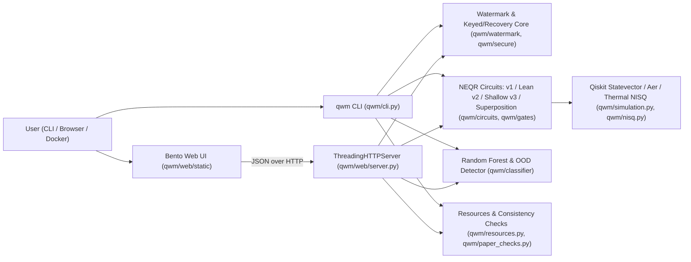

# Software Development Lifecycle (SDLC) Documentation

This document records how `neqr-quantum-watermarking` (`qwm`) implements every phase of the software development lifecycle.

## 1. Planning & Requirements Traceability

| ID | Requirement | Implementation Modules | Verification Tests |
| :--- | :--- | :--- | :--- |
| `FR-1` | Paper NEQR `v1` reversible logic (`RPA`, `RPS`, `D4`, `QE`) & unitary inverse `Eqs. 12-16` | [`qwm/gates/`](../qwm/gates/), [`qwm/circuits/`](../qwm/circuits/) | `tests/test_gates.py`, `tests/test_circuits.py`, `tests/test_neqr.py` |
| `FR-2` | Classical vectorized reference (`paper`, `lsb`, `opap`) + BER / NC / PSNR / SSIM metrics | [`qwm/watermark/`](../qwm/watermark/), [`qwm/metrics/`](../qwm/metrics/) | `tests/test_watermark.py`, `tests/test_metrics_attacks.py` |
| `FR-3` | Keyed blind authentication & self-recovery (`keyed`, `keyed-opt`, `recovery`, `recovery-dual`, RGB support) | [`qwm/secure/`](../qwm/secure/) | `tests/test_v2_studies.py`, `tests/test_enhancements_v3.py` |
| `FR-4` | Lean Cuccaro (`v2`) & Shallow Brent-Kung CLA (`v3`) circuits + NISQ T1/T2 thermal study | [`qwm/circuits/lean.py`](../qwm/circuits/lean.py), [`qwm/circuits/shallow.py`](../qwm/circuits/shallow.py), [`qwm/nisq.py`](../qwm/nisq.py) | `tests/test_lean_circuits.py`, `tests/test_shallow_circuits.py`, `tests/test_enhancements_v3.py` |
| `FR-5` | Coherent NEQR superposition PPB & Grover tamper search | [`qwm/circuits/superposition.py`](../qwm/circuits/superposition.py) | `tests/test_superposition.py` |
| `FR-6` | Forensic attack classifier (`137-d` & `162-d` descriptors) + calibrated open-set rejection | [`qwm/classifier/`](../qwm/classifier/) | `tests/test_classifier_resources.py`, `tests/test_v2_studies.py` |
| `FR-7` | Simple CLI (`qwm run`, `qwm ui`), Paper Tables API (`/api/paper`), and Bento web studio | [`qwm/cli.py`](../qwm/cli.py), [`qwm/web/`](../qwm/web/) | `tests/test_cli.py`, `tests/test_web.py`, `tests/test_enhancements_v3.py` |
| `NFR-1` | Offline reproducibility & paper consistency verification (Table 9, PSNR bounds, Table 11/21) | [`qwm/paper_checks.py`](../qwm/paper_checks.py), [`qwm/resources.py`](../qwm/resources.py), [`scripts/reproduce_all.sh`](../scripts/reproduce_all.sh) | `tests/test_v2_studies.py` |
| `NFR-2` | Input validation, path traversal guard, bounded session LRU cache, health probe | [`qwm/web/server.py`](../qwm/web/server.py) | `tests/test_web.py` |

## 2. System & Architecture Design



### API Surface ([`qwm/web/server.py`](../qwm/web/server.py))
- `GET /api/health` — liveness/readiness JSON (`status`, `version`, `uptime_s`, `active_sessions`, `classifier_ready`).
- `GET /api/meta`, `GET /api/resources`, `GET /api/paper` — datasets, circuit budgets, Table 9/11/21 summaries.
- `POST /api/embed`, `/api/attack`, `/api/verify`, `/api/classify`, `/api/block`, `/api/nisq_block` — bounded to `12 MiB` JSON objects and `40` LRU sessions.

## 3. Implementation & Build Packaging

- Packaged via [`pyproject.toml`](../pyproject.toml) (`setuptools.build_meta`), exposing the `qwm` console script and bundling `qwm/web/static/*`.
- Single version source synced across [`qwm/version.py`](../qwm/version.py), [`pyproject.toml`](../pyproject.toml), and [`CHANGELOG.md`](../CHANGELOG.md).

## 4. Testing & Quality Assurance Strategy

- **Lint & Security**: `ruff check qwm tests scripts` + `ruff check --select S qwm` (Bandit security subset).
- **Automated Unit/Integration + Coverage**: `pytest --cov=qwm --cov-fail-under=85 -q` (`198` tests covering exact gate truth tables, unitary equivalence, blind recovery, open-set forensics, NISQ simulation, CLI, and HTTP errors).
- **Browser & Responsive E2E**: Interactive desktop (`1440×900`) and mobile (`390×844`) Playwright verification of custom PNG upload, brush painting, blind recovery, NISQ charts, theme switching, and Paper Tables.
- **Notebook & Reproducibility**: All `13` cells in [`notebooks/walkthrough.ipynb`](../notebooks/walkthrough.ipynb) and `QUICK=1 OFFLINE=1 bash scripts/reproduce_all.sh`.

## 5. Deployment, Operations & CI/CD

- **CI Pipeline**: [`.github/workflows/ci.yml`](../.github/workflows/ci.yml) runs on every push/PR across Python `3.10` and `3.12`: lint, security lint, pytest coverage gate (`>= 85%`), wheel build + static asset check, and CLI + health smoke run.
- **Container Deployment**: [`Dockerfile`](../Dockerfile) runs `qwm ui` under non-root user `qwm` with a built-in `/api/health` container `HEALTHCHECK`.

```bash
docker build -t qwm:3.0.1 .
docker run --rm -p 8765:8765 qwm:3.0.1
```

## 6. Maintenance & Governance

- Security boundaries and disclosure steps: [`SECURITY.md`](../SECURITY.md)
- Contributor workflow and verification checklist: [`CONTRIBUTING.md`](../CONTRIBUTING.md)
- Release history: [`CHANGELOG.md`](../CHANGELOG.md)
